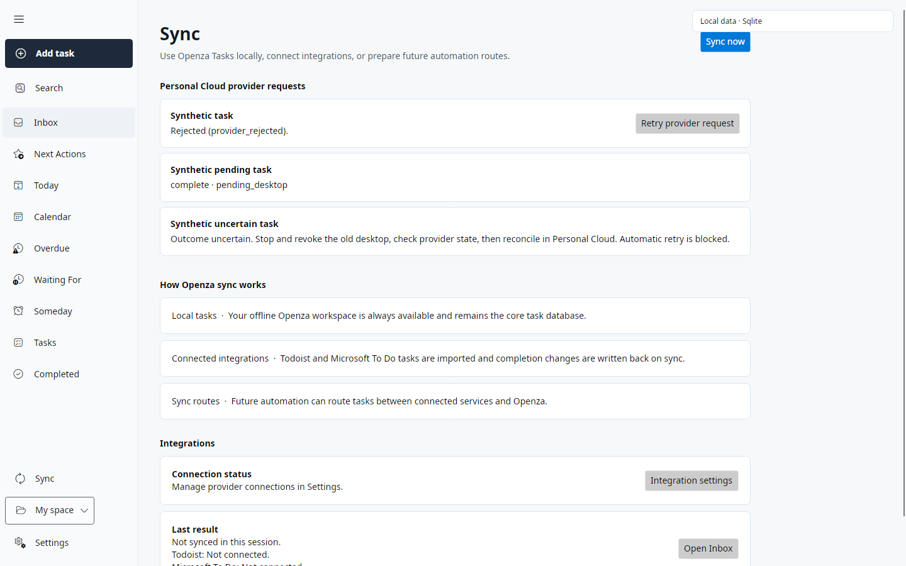

# Desktop provider delivery

The Avalonia Desktop sync pass downloads Personal Cloud requests, delivers completion or reopening through a connected Todoist or Microsoft To Do account, and uploads the resulting confirmation or rejection. Provider credentials remain in the local credential store. Personal Cloud receives the source kind, hashed source identity, safe source descriptor, claim identity, and bounded result code.

Provider delivery requires protocol 1, cloud schema 20, a desktop paired with the `provider_bridge` capability, and one unambiguous source match in the currently connected account. Ordinary replica sync can still read compatible earlier cloud schemas. Upgrade Personal Cloud before enabling delivery on an older installation. GitHub issue references do not provide a completion adapter.

Before claiming, Desktop fetches a fresh snapshot through the configured provider. It checks the exact source hash and provider connection and records a local account binding. A missing connection, failed refresh, changed account, duplicate provider source, or multiple Openza tasks for the same provider item prevents dispatch. The cloud also enforces source uniqueness and exclusive ownership transactionally.

## Durable attempt states

The local schema 9 journal preserves commands, source descriptors, claims, and results independently of task-row deletion. Additive SQL is in `src/Openza.Tasks.Core/Data/Migrations/0009_personal_cloud_provider_bridge.sql`; normal store initialization creates these tables. The provider command journal is separate from the legacy completion queue.

1. Desktop stores a stable claim ID before the claim request.
2. It records `starting` before contacting the start endpoint, then uses a database compare-and-swap to enter `dispatching` before the provider call. A per-replica process lease excludes competing dispatchers.
3. A successful response stores the result and its immutable semantic outbox entry in one SQLite transaction. Lost cloud result responses replay the same outbox bytes and mutation identity.
4. Timeout, cancellation, transport failure, crash, or an HTTP 5xx after dispatch produces an uncertain attempt. A restarted Desktop never repeats that provider action automatically, including recurring Todoist completion.

Known no-effect HTTP 400/404/422 responses produce `provider_rejected`; 401/403 produce `authentication_required`; 429 produces `retry_exhausted`. These classifications do not include generic server or transport failures. A rejected request can be retried explicitly from Sync. Its stable retry ID survives a lost response; the new request arrives through the normal ordered feed and requires a new claim.

An uncertain result requires the existing owner reconciliation procedure in Personal Cloud: stop and revoke the old desktop, inspect the provider's actual state, then reconcile the claim. Reconciliation permits a clean replacement replica; it does not rewrite old device history or discard its preserved local journal. Export the old local database before any separately approved cleanup. Pairing, disconnecting, or bootstrap replacement remains blocked while unresolved local intents or active attempts would be lost.

Pre-bridge legacy completion rows for cloud-managed tasks are retained for recovery and excluded from direct provider dispatch. They cannot bypass the claim path or replay an uncertain action.

## Source snapshots and user fields

Fresh snapshots use the same ordered semantic device sequence as task edits and results, without changing Openza-owned entity versions. An accepted source/result receipt cannot invent a newer base for unsynchronized user fields.

The cloud accepts stale/equal same-identity snapshots as durable no-effect receipts and returns authoritative facts in the feed. A queued snapshot for a known deleted source also receives a no-effect receipt and the existing deletion/tombstone facts. Neither path resurrects a task or overwrites a newer provider snapshot. Wrong or never-known source bindings remain errors. Ordinary user-edit conflicts are preserved for explicit resolution.

## Validation

The native Sync view below uses synthetic tasks. Retry is available for a known rejection and disabled while synchronization runs; an uncertain provider outcome cannot be retried automatically.



Deterministic bridge tests cover shared golden envelopes, restart and lost response handling, capability/source/account checks, competing replicas, immutable results, explicit retry, legacy queue preservation, and repeated deletion facts.

The actual Worker acceptance fixture uses separate disposable local D1 state, seeded synthetic device credentials, real `HttpClient`, real Desktop SQLite, and a synthetic provider. The fixture must have protocol 1/schema 20, instance `instance_bridge_acceptance_0001`, devices `device_bridge_acceptance_a`/`device_bridge_acceptance_b`, and the synthetic refresh values documented in the acceptance test. Preserve a failed fixture; create a fresh disposable fixture for a rerun because Desktop semantic sequence history is durable.

With that fixture running, execute:

```sh
OPENZA_BRIDGE_ACCEPTANCE_ORIGIN=http://127.0.0.1:8789/ dotnet test src/Openza.Tasks.Tests/Openza.Tasks.Tests.csproj -c Release -p:OpenzaChannel=Dev --filter FullyQualifiedName~PersonalCloudProviderBridgeWorkerAcceptanceTests
```

The harness rejects remote origins. Without the opt-in environment variable, the normal suite reports this acceptance test as skipped. A skipped run is not actual Worker acceptance. Synthetic HTTP headers exist only in the test transport and require the Worker's existing `TEST_MODE`; the product sender contains no authentication bypass. These checks do not prove live Todoist/Microsoft account acceptance or an approved production deployment.
